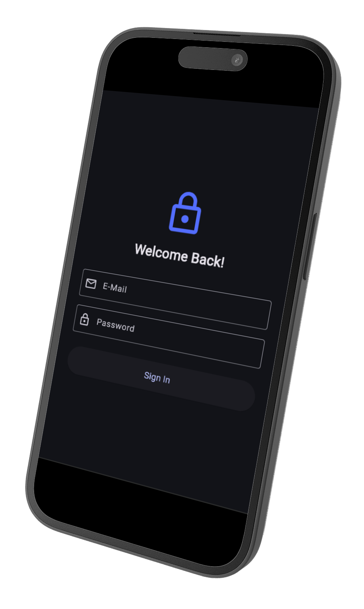
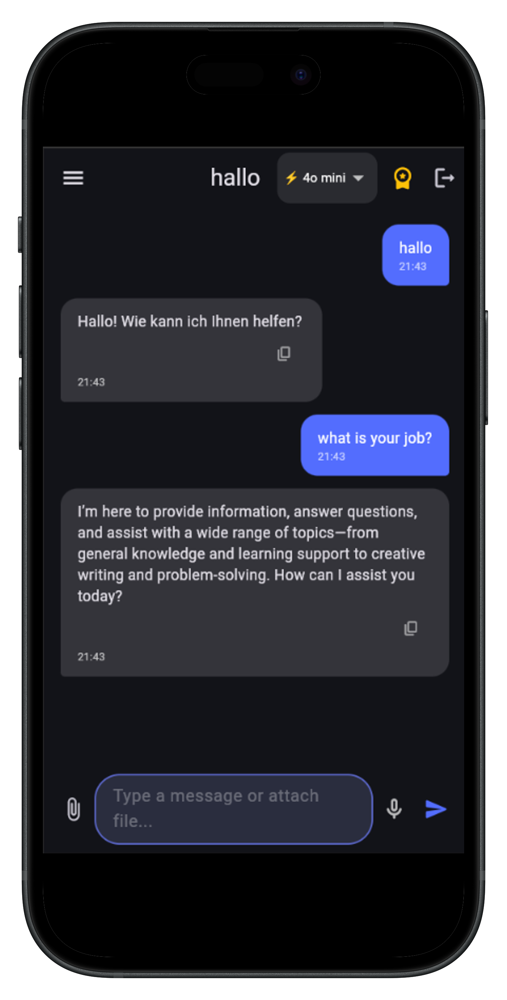
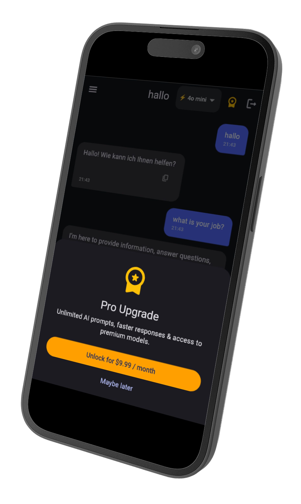
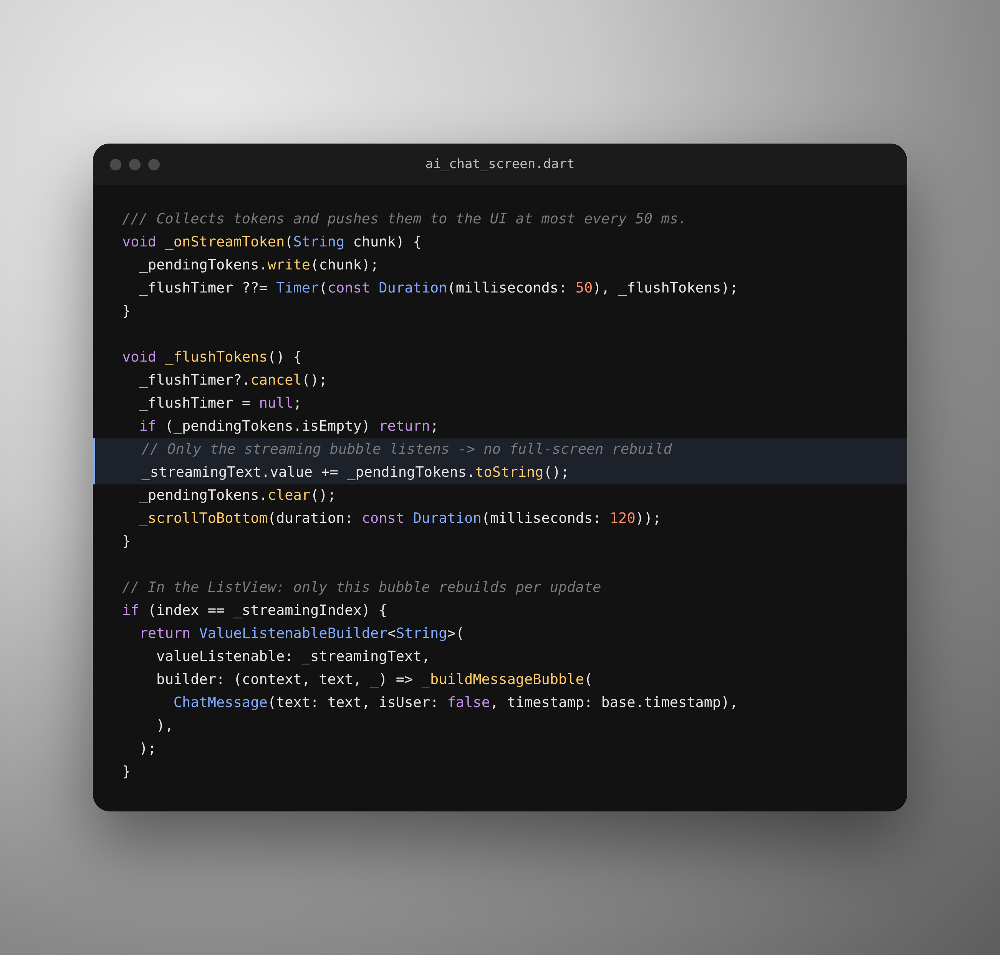

# Flutter AI Starter Kit

**Launch your AI-powered Flutter app in days, not months.**

A ready-to-run Flutter template with AI chat, auth, chat history and a paywall,
so you can skip 40+ hours of setup and focus on what makes your app unique.

---

## 📱 Screenshots

  
  
  
  

---

## ⚡ Features

### 🧠 AI Chat with OpenAI
- **Real-time streaming** answers (Server-Sent Events), rendered smoothly. Only the active message rebuilds, not the whole screen
- **Smart auto-scroll** that follows the answer and stops as soon as you scroll up to read
- **Image understanding**: attach a photo and the AI can see it
- **Model switching** between GPT-4o mini and GPT-4o, right in the chat
- **Custom AI personality**: change one system prompt to turn it into a fitness coach, support agent or anything else
- Markdown answers with one-tap copy

### 🎙️ Hands-Free Voice Input
- Speech-to-text with auto-silence detection and auto-send

### 💬 Full Chat Experience
- Chat history saved per user
- Pin, rename and delete chats
- Image & file attachments via Supabase Storage

### 🛡️ Supabase Backend, Secure by Default
- Email authentication (sign up, sign in, sign out)
- **Row Level Security**: every user only sees their own chats and files
- Optimized RLS policies and indexes, and **one SQL file** sets up the whole database in under a minute

### 💳 Monetization Ready
- Paywall UI with demo mode
- Prepared for RevenueCat in-app purchases

### 🔑 No Keys in the Code
- All keys live in one `.env` file
- Missing a key? The app shows a clear setup screen instead of crashing

---

## 🧩 Under the Hood

  

Tokens are collected and pushed to the UI at most every 50 ms, and only the bubble that is currently being written rebuilds. That is the difference between a chat that stutters and one that feels smooth.

---

## 🛠️ Tech Stack

| Area | Technology |
|---|---|
| App | Flutter / Dart (iOS, Android, Web) |
| State & Navigation | Riverpod, go_router |
| Backend | Supabase (Auth, Postgres, Row Level Security, Storage) |
| AI | OpenAI API (GPT-4o, GPT-4o mini) |
| Payments | RevenueCat (prepared) |
| Config | flutter_dotenv |

---

## 🚀 How It Works After Purchase

1. Download the `.zip` and open the project
2. Open the included `.env` file and paste your OpenAI and Supabase keys
3. Run `schema.sql` once in the Supabase SQL Editor
4. `flutter pub get` → `flutter run` 🎉

A step-by-step README with a troubleshooting table is included. Setup takes about 15 minutes.

> **Note:** This repository is a showcase. The full source code is delivered as a `.zip` after purchase.

---

## 💰 Pricing

| | **Single Use** | **Multi Use** |
|---|:---:|:---:|
| Price | **CHF 99** | **CHF 249** |
| Projects | 1 personal or commercial app | Unlimited personal or commercial apps |
| Full source code | ✅ | ✅ |
| One-time payment, no subscription | ✅ | ✅ |

See [`commercial_license.txt`](commercial_license.txt) for the full license terms.

---

## ❓ FAQ

**Do I need a Mac?**
Only to build for iOS. Android and Web work on Windows, macOS and Linux.

**Which services do I need?**
A free Supabase project and an OpenAI API key. RevenueCat is only needed once you switch the paywall to real purchases.

**Is my OpenAI key safe?**
For development, the key is read from `.env`. Before publishing your app, we recommend moving the OpenAI call into a Supabase Edge Function so the key stays on the server. The README explains where to change it.

**Can I sell apps I build with it?**
Yes. Single Use covers one app, Multi Use covers unlimited apps. You can't resell the kit itself as a template.

---

Built by **Dohama Systems** · Questions? **support@dohamasystems.com**

